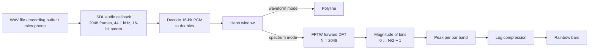

# Musico: Audio Visualizer


> A real-time audio visualizer written in C++ with SDL2 and FFTW3. It turns a WAV file, a microphone recording, or live microphone input into a frequency spectrum or a waveform while the audio plays.

**Demo:** https://youtu.be/W0MV3Ehnk0A

## Features

- **Three audio sources**
  - **Play music**: pick a `.wav` file in a native file dialog (optionally downloading it from YouTube first) and visualize it during playback.
  - **Record & play back**: record from the microphone (up to 10 minutes, with pause), then play the recording back with visualization and replay.
  - **Real-time**: visualize live microphone input as it is captured.
- **Two visualizations**, switchable at any moment
  - **Spectrum bars**: the FFT magnitude spectrum drawn as rainbow bars.
  - **Waveform**: the time-domain signal drawn as a continuous line.
- **Fast Fourier Transform with FFTW3**, preceded by a Hann window and followed by magnitude calculation, per-band peak detection and log scaling.
- **HSV color cycling** that runs across the bars and shifts over time.
- **Playback controls**: pause (with freeze-frame), stop, replay and mode toggle, by mouse or keyboard.
- **Resizable window**: control positions and the number of bars follow the window size.
- **Builds on Linux and 64-bit Windows**, with the Windows libraries and DLLs bundled in the repository.

## Built with

| Library | Used for |
|---|---|
| [SDL2](https://www.libsdl.org/) | window, hardware-accelerated renderer, audio playback and capture |
| SDL2_image | loading PNG UI assets |
| SDL2_ttf | rendering status text |
| [FFTW3](https://www.fftw.org/) | the Fast Fourier Transform |
| [tinyfiledialogs](https://sourceforge.net/projects/tinyfiledialogs/) | native message box, text input and file-open dialogs |
| youtube-dl + ffmpeg | optional: downloading audio from YouTube as WAV |

## How it works

### Signal pipeline



The audio callback drives the visualization. Every time SDL hands the program an audio buffer (to fill for playback, or freshly captured from the microphone), [`visualizerOutput()`](src/visualize.cpp) analyses that buffer and draws one frame. A buffer is 2048 frames, about 46 ms at 44.1 kHz, so the picture keeps pace with the sound.

### 1. Decoding PCM samples

[`Get16bitAudioSample()`](src/visualize.cpp) builds a 16-bit value from two bytes. It checks the endianness bit (bit 12) and the signedness bit (bit 15) of the `SDL_AudioFormat` to read the bytes correctly. Signed samples are divided by $2^{15}$, giving values in $[-1, 1)$, and unsigned samples by $2^{16}-1$, giving $[0, 1]$. The visualizer takes `SAMPLES` = 2048 consecutive 16-bit samples from each buffer.

### 2. Hann window

Before the transform, each sample is multiplied by a Hann window:

$$w[n] = \sin^2\left(\frac{\pi n}{N}\right) = \frac{1}{2}\left(1 - \cos\frac{2\pi n}{N}\right), \qquad n = 0, \dots, N-1$$

The DFT treats its input as one period of a repeating signal. A block cut from continuous audio usually has a jump where its end wraps around to its start, and that jump spreads energy into unrelated frequency bins (spectral leakage). Fading both ends of the block to zero removes the jump, so the peaks in the spectrum are sharper.

### 3. Fourier transform with FFTW

The windowed samples go into the real parts of a complex input array, with the imaginary parts set to zero. FFTW then computes the forward discrete Fourier transform

$$X[k] = \sum_{n=0}^{N-1} w[n]\,x[n]\,e^{-2\pi i k n / N}$$

using an $O(N \log N)$ FFT instead of the $O(N^2)$ direct sum.

The plan (`fftw_plan_dft_1d`, `FFTW_FORWARD`, `FFTW_ESTIMATE`) is created once at startup inside the [`complexData`](include/visual_struct.h) struct. Every buffer then runs `fftw_execute()` on that same plan, so no planning happens on the audio path. On exit the plan is destroyed and FFTW is cleaned up.

The input is real, so the spectrum is conjugate-symmetric and only bins $0 \dots N/2 - 1$ are needed. Bin $k$ corresponds to the frequency

$$f_k = k \cdot \frac{f_s}{N} = k \cdot \frac{44100}{2048} \approx k \times 21.5\ \text{Hz}$$

and its strength is the magnitude $|X[k]| = \sqrt{\mathrm{Re}(X[k])^2 + \mathrm{Im}(X[k])^2}$.

### 4. From spectrum to bars

- **Bar count:** the window width divided by 15 px (`THICKNESS`). Each bar is 15 px wide and starts 16 px (`DIST`) after the previous one, which leaves a 1 px gap.
- **Bands:** bar $i$ covers the linear band $(22i,\ 22(i+1)]$ Hz, which holds about one FFT bin. At the default 800 px width, the visible bars span roughly 0 to 1.1 kHz, the bass and low-mid range where most musical energy sits.
- **Peak detection:** a bar's value is the largest magnitude among the bins in its band.
- **Log scaling:** values above 2 are replaced by their natural logarithm, so loud bins don't dwarf quiet ones. The result is multiplied by 60 px (`SCALE`) to get the bar height.

### 5. Waveform view

Waveform mode skips the FFT. The 2048 windowed samples are drawn as a single polyline with `SDL_RenderDrawLines`. The x positions are scaled so the block fills the window width, and $y = \tfrac{\text{height}}{2} - \text{sample} \times 100$ (`VSCALE`). The samples are windowed, so the line flattens towards the centre at both edges.

### 6. Color

The [`rgb`](include/visual_struct.h) struct converts a hue between 0° and 360° to RGB at full saturation and value, using the standard six-sector HSV→RGB formula. A hue offset advances by 1° per frame, and bar $i$ is drawn at hue $(\text{offset} + 2i) \bmod 360$. This gives a rainbow across the spectrum that rotates over time. The waveform is drawn in the current hue.

### Recording and playback

- **Buffer:** when recording starts, [`createDefaultRecData()`](src/rec.cpp) allocates room for 600 s (`MAX_RECORDING_SECONDS`) plus 1 s of headroom. The size comes from the spec the capture device actually granted (rate × channels × bytes per sample), about 106 MB at 44.1 kHz, 16-bit stereo.
- **Callbacks:** the capture callback appends each incoming buffer. The playback callback visualizes a buffer and then fills it from the recording, moving a byte cursor forward.
- **Thread safety:** SDL runs these callbacks on its audio thread, so the main loop reads the cursor under `SDL_LockAudioDevice()`. Recording ends when the 600 s limit is reached or the user stops it, and the cursor position at that point becomes the length of the recording.
- **States:** the mode runs as a small state machine:

  `startscreen → recording ⇄ paused → recorded → playing ⇄ paused → doneplaying → (replay) → playing`

### Interface

- The start menu scrolls its background endlessly: the same image is drawn twice side by side and shifted on every frame.
- Pausing freezes the last frame. The renderer is read back with `SDL_RenderReadPixels` into a texture, which is redrawn under a play button until playback resumes.
- Round buttons use a circular hit test (distance from the centre ≤ radius). The mode toggle and the menu entries use rectangle tests.
- Every control's position is recomputed from the window size on each frame, so the layout scales when the window is resized.
- The animated "Recording…" text is rendered once with SDL_ttf into four textures, which the screen cycles through to animate the dots.
- The YouTube option runs `youtube-dl -x --audio-format wav` in the background and saves the result into `wav/`. The file dialog opens straight afterwards, filtered to `*.wav`.
- On Windows (`-DOS2`), the program selects the DirectSound audio driver and changes to the parent directory, so the executable in `bin64/` can find `res/`.

## Tuning constants

These are defined in [include/preprocessors.h](include/preprocessors.h):

| Constant | Value | Meaning |
|---|---|---|
| `WINDOW_WIDTH` × `WINDOW_HEIGHT` | 800 × 600 | initial window size |
| `RATE` | 44100 | sample rate (Hz) |
| `SAMPLES` | 2048 | audio buffer size and FFT length $N$ |
| `THICKNESS` | 15 | bar width (px) |
| `DIST` | 16 | distance between bar starts (px) |
| `SCALE` | 60 | bar height multiplier |
| `VSCALE` | 100 | waveform amplitude multiplier |
| `MAX_RECORDING_SECONDS` | 600 | recording limit (s) |

## Project structure

```
src/
  main.cpp          entry point, command-line parsing, mode loop, global state
  visualize.cpp     PCM decoding, Hann window, FFT, spectrum and waveform rendering
  musicMode.cpp     WAV playback mode
  rec.cpp           record-and-play-back mode (state machine)
  realtime.cpp      live microphone mode
  ui.cpp            start menu, file and YouTube dialogs, recording screens
  utilities.cpp     SDL setup and teardown, audio callbacks, hit tests, asset loading
  native-toolkit/   tinyfiledialogs
include/            project headers, plus bundled SDL2, FFTW3 and tinyfiledialogs headers
lib/                bundled Windows libraries
bin64/              Windows DLLs; the Windows build writes musico.exe here
res/                UI images and fonts
```

## Building and running

### Linux

On Debian or Ubuntu, `install.sh` installs `build-essential`, `libsdl2-dev`, `libsdl2-image-dev`, `libsdl2-ttf-dev`, `libfftw3-dev`, `ffmpeg` and `python-is-python3`, and puts `youtube-dl` in `/usr/local/bin`:

```bash
sudo sh install.sh
make
./musico
```

On other distributions, install the equivalent packages. `youtube-dl` and `ffmpeg` are needed only for the YouTube download feature. glibc 2.29 or newer is required (preinstalled from Ubuntu 19.04 onwards).

### Windows (64-bit)

1. Install [MinGW-w64 GCC](https://winlibs.com/) with the **posix** thread model. With [Chocolatey](https://chocolatey.org/), run `choco install winlibs-llvm-free`.
2. Run `install.ps1` in PowerShell. It installs Scoop, then `youtube-dl`, `ffmpeg` and `make`.
3. Run `make`. It links against the bundled SDL2 and FFTW3 libraries and writes `bin64\musico.exe`.
4. Start the program from inside `bin64` (it loads its assets from the parent directory):

   ```powershell
   cd bin64
   .\musico.exe
   ```

## Usage

```bash
./musico                 # open the start menu
./musico -f song.wav     # play and visualize a WAV file
./musico -r              # record from the microphone, then play it back
./musico -R              # visualize microphone input in real time
```

| Action | Key | Mouse |
|---|---|---|
| Start recording / pause / resume / replay | `Space` | round button, top left |
| Stop recording, or leave the mode and return to the menu | `q` | stop button, next to it |
| Switch between bars and waveform | `m` | button, top right |
| Exit | n/a | close the window |

## Known issues

- WAV playback assumes 16-bit stereo PCM at 44.1 kHz, because the output device is always opened with that spec. Files in other formats play at the wrong speed or pitch.
- Window resizing doesn't work on Windows, because of an issue in Microsoft's OpenGL implementation ([libsdl-org/SDL#1059](https://github.com/libsdl-org/SDL/issues/1059)).
- If the YouTube URL dialog stays open for a long time, the OS may mark the program as not responding. The dialog blocks the main thread, which is also the thread that services the SDL event loop. Running the dialog on a separate thread would fix this.
